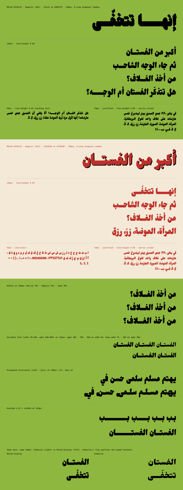

# Melad Display

A condensed, heavy Arabic headline face for melad's 1080×1350 carousels. It's derived from
[Jomhuria](https://fonts.google.com/specimen/Jomhuria) (SIL OFL 1.1) and keeps Jomhuria's full
OpenType shaping, Persian/Urdu letters and Latin.



## Files

| Path | What |
|---|---|
| `fonts/ttf/MeladDisplay-Black.ttf` | **Regular, 84% width.** Drop-in for the "Original" option |
| `fonts/ttf/MeladDisplayNarrow-Black.ttf` | Narrow, 78% |
| `fonts/ttf/MeladDisplaySemi-Black.ttf` | Semi, 90% |
| `fonts/woff2/*.woff2` | Same three for the web |
| `fonts/variable/MeladDisplay[wdth,wght].ttf` / `.woff2` | Variable: `wdth` 78–100 (default 84), `wght` 400–900 (default 900) |
| `fonts/melad-display.css` | Ready `@font-face` rules for all of the above |
| `specimen/melad-display-specimen.png` | 2160px specimen rendered in Chromium |
| `sources/` | `build.py` (the real source), Jomhuria, UFO masters + designspace |
| `tests/` | Join and line-height checks, `hb-view` renders |

"Width %" is measured, not nominal: on the brief's test strings the statics set at **78.4 / 84.2 /
90.0 %** of Jomhuria's width.

## Using it on the canvas

```html
<link rel="stylesheet" href="fonts/melad-display.css">
<h1 style="font-family:'Melad Display'; font-size:300px; line-height:.98">إنهـــــــا تتخفّـــى</h1>
```

* The statics are the safest drop-in. They look the same whatever `font-weight` the element has.
* With the **variable** font, CSS picks the axes from `font-weight` / `font-stretch`. Unless you
  set them, browsers ask for weight 400 and width 100% (Jomhuria's width and weight), so use the
  `.melad-vf` class or `font-weight:900; font-stretch:84%`.
* Elongated letters: `font-feature-settings: "ss02" 1` (also `"jalt"`). They cover medial ـهـ,
  medial ـسـ/ـشـ and ـلـ, and final ى ی ي ن.
* Line box is identical to Jomhuria (3000 UPM, hhea/typo 1840 / −1160, gap 0,
  USE_TYPO_METRICS), so existing line-heights don't move.

## Rebuilding

```sh
pip install fonttools skia-pathops uharfbuzz skia-python numpy brotli ufoLib2
cd sources && python3 build.py && python3 export_ufo.py
python3 ../tests/check_joins.py ../fonts/ttf/MeladDisplay-Black.ttf Jomhuria-Regular.ttf
NODE_PATH=$(npm root -g) node ../specimen/render.cjs     # needs Playwright + Chromium
```

Design parameters (weight, condensing, tatweel length, alternates, gap rules) are constants at the
top of `sources/build.py`. The UFOs in `sources/ufo/` are exported from the build. They compile
with fontmake (layout tables ride along as TTX in each UFO's data folder), but change
`build.py`, not the UFOs.

## Verification

| Check | Result |
|---|---|
| Joins: every init/medi/fina edge vs. the tatweel stroke (`tests/check_joins.py`) | 1014 edges, **0 mismatches**. 109 edges that Jomhuria itself slants on purpose (ع، ڭ…) keep that slant |
| Overlaps, static TTFs | **none** (removed and re-verified) |
| Overlaps, variable font | 14 rare glyphs in the default master keep tiny self-overlaps (ݯ, ڃ, ۖ, ݴ/ݳ lam-alef, ھ medial (Urdu), math letters, ĸ…), flagged `OVERLAP_SIMPLE` so they fill correctly. None occur in the test strings or the basic Arabic/Persian/Urdu set |
| `fontbakery check-universal` | variable: 0 FAIL, 0 ERROR (11 WARN); statics: 0 FAIL, 0 ERROR (30 WARN across 3 files). Remaining warnings are inherited from Jomhuria (3000 UPM, no ligature carets, soft hyphen, GDEF mark classes, caron forms, math widths) |
| OTS (what Chrome runs on web fonts) | all files pass |
| HarfBuzz `hb-view` | `tests/hb-view/*.png` (hb-view has no bidi, so digit runs show reversed there; Chrome is correct) |
| Chrome | Chromium via Playwright: all four faces load, variable axes respond, 8-step shadow, justification, 0.85 stacking (see specimen) |
| Safari | **not tested.** No WebKit in this build environment; please check on a Mac/iPhone |

### Line-height 0.85

The marks sit about 80 units higher than in Jomhuria (the letter and the mark are both heavier, and
the gap between them is kept). The worst stack in the test set, أُمّ under a ي/ف descender, overlaps
at line-height 0.85 in **both** Jomhuria (by 646 units) and Melad (by 824). Shadda or hamza over
lam/alef under ordinary descenders (ر و ن) clears at 0.85. `tests/check_vertical.py` prints the
numbers.
