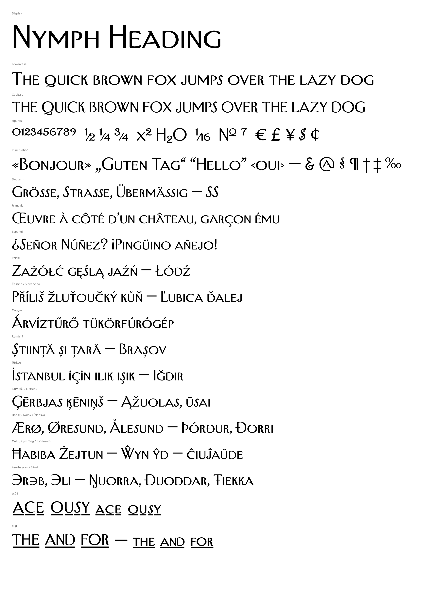

# Nymph Heading

A rebuilt version of the caps-only display face *Irvin Heading 1.001*. This version adds a real lowercase and full European Latin coverage.



## What changed from the original

**Lowercase.** In the original, `a`–`z` were byte-for-byte copies of `A`–`Z`. They are now **small capitals** drawn from the capitals. Each one is scaled to a 1150-unit x-height and then thickened on both axes so it matches the caps: stems come out at about 92 % of the capital stem and hairlines at about 90 %. Plain scaling would make them look thin and washed out. The thickening keeps the point structure, so corners stay sharp. Small caps also get slightly wider proportions and a little extra spacing. The result is a caps-and-small-caps design, like Trajan or Copperplate, rather than a set of drawn lowercase forms.

**Character set.** The font now has 584 glyphs and 429 characters, up from 254 glyphs:

- Basic Latin and Latin-1 are complete. The original was missing `{ } ¤ ¦ § ª « ¬ ± ² ³ µ · ¹ º » ¼ ½ ¾ × Ð Ý Þ ð ý þ`.
- Latin Extended-A is complete except `ſ` (long s).
- From Latin Extended-B and Latin Extended Additional: `Ə ə Ǧ ǧ Ǻ ǻ Ǽ ǽ Ǿ ǿ Ș ș Ț ț ȷ Ẁ ẁ Ẃ ẃ Ẅ ẅ Ỳ ỳ Ẽ ẽ Ỹ ỹ ẞ`.
- Together these cover every Latin-script European language: Western, Central and Eastern European, Baltic, Nordic and Icelandic, Turkish and Azerbaijani, Romanian, Maltese, Welsh, Sámi, Esperanto, Catalan and others.
- Windows-1252 is complete, including `ƒ † ‡ ‰ ‹ › Š š Ž ž`. Windows code pages 1250 (Central Europe), 1254 (Turkish) and 1257 (Baltic) are complete too.
- New symbols: `− × ± ≠ ≈ ≤ ≥ ¬ № ⁄`, superior and inferior figures `⁰¹²³⁴⁵⁶⁷⁸⁹ ₀₁₂₃₄₅₆₇₈₉`, and `fi fl`.
- Combining accents U+0300–0304, 0306–0308, 030A–030C and 0326–0328. They attach correctly to any letter through `mark`/`mkmk` anchors, and they stack: for example `ǻ`, or `a` followed by ◌́ and ◌̂.

**OpenType features**

| Feature | What it does |
|---|---|
| `kern` | The original kerning, extended to every accented letter. Lowercase–lowercase and mixed-case pairs are scaled to suit. |
| `mark`, `mkmk` | Position accents on any base letter, and stack them. |
| `locl` | Turkish, Azerbaijani, Crimean Tatar, Kazakh and Tatar get a dotted `i`. Romanian and Moldovan `ş ţ` become `ș ț`. |
| `c2sc` | Turns capitals into small caps (all small caps). |
| `case` | Raises guillemets and the middle dot for all-caps text. |
| `frac`, `numr`, `dnom` | `1/2` becomes ½-style fractions, for any digits. |
| `sups`, `subs`/`sinf`, `ordn` | Superiors, inferiors, ordinals (`ª º №`). |
| `ss01` | The original underscored alternates, now in both caps and small caps. |
| `dlig` | The original ligatures (`THE AND FOR LL …`). All-lowercase input gets small-cap ligatures. |

**Engineering**

- TrueType output is hinted with ttfautohint and OpenType/CFF output with otfautohint.
- Vertical metrics are consistent across hhea, typo and win, with `USE_TYPO_METRICS` set and no clipping of accents.
- All four files pass the OpenType Sanitizer, the font checker Chrome and Firefox use.

## Files

| Path | Use |
|---|---|
| `fonts/otf/NymphHeading-Regular.otf` | Desktop apps (Adobe, Affinity, Office, Figma, macOS and Windows) |
| `fonts/ttf/NymphHeading-Regular.ttf` | Desktop, Android, games and engines, anything that wants TrueType |
| `fonts/webfonts/NymphHeading-Regular.woff2` | Web, for all current browsers |
| `fonts/webfonts/NymphHeading-Regular.woff` | Web fallback for older browsers |
| `fonts/webfonts/nymph-heading.css` | A ready-made `@font-face` rule |
| `source/NymphHeading-Regular.ufo` | Editable source; opens in Glyphs, FontLab, RoboFont or Fontra |
| `source/NymphHeading-Original.ttf` | The untouched input |
| `specimen/glyphs.png` | Every glyph, with its code point |
| `specimen/text.png` | Language and feature samples |
| `specimen/index.html` | Live specimen with a type tester; open it locally |

## Rebuilding

```bash
pip install -r tools/requirements.txt
```

```bash
python3 tools/build.py
```

```bash
python3 tools/specimen.py
```

`build.py` regenerates everything from `source/NymphHeading-Original.ttf`. The UFO is an output of the build, so any design change belongs in the script, not in the UFO.

## Constructed glyphs

These glyphs had no source in the original. They were assembled from its own parts:

- **From existing glyphs:** `Ð Đ Ł Ħ Ŧ` add a stroke made from the hyphen. `Þ` moves the P bowl. `Ŋ` combines N with the J tail. `Ə` is a turned C with a bar. `ƒ` is built from J. `† ‡` from I. `§` from S. `{ }` from the parentheses. `‰` from %.
- **Accents:** the caron, dot, ring, double acute, comma accent and ogonek come from the existing accents.
- **Drawn as geometry:** the breve and `¤`.

They match the weight and contrast of the original but were not drawn by hand. Look over `ƒ`, `Ə`, `§` and `Ŋ` in particular before using them anywhere prominent.

## Not in this pass

- `ſ` (long s).
- Vietnamese.
- Greek and Cyrillic.
- Mac-Roman math (`∂ ∆ ∏ ∑ √ ∫ ∞ Ω π ◊`).
- Arabic, which is planned next.

## Licence

The original file has no copyright or licence string, and its `fsType` is set to 4 (preview & print embedding). Check the licence of Irvin Heading before you redistribute this font or use it commercially. That also applies to keeping it in a public repository.
