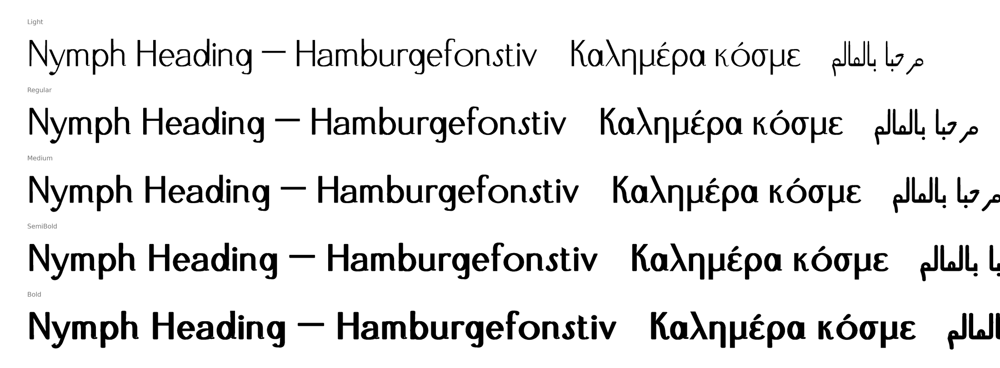
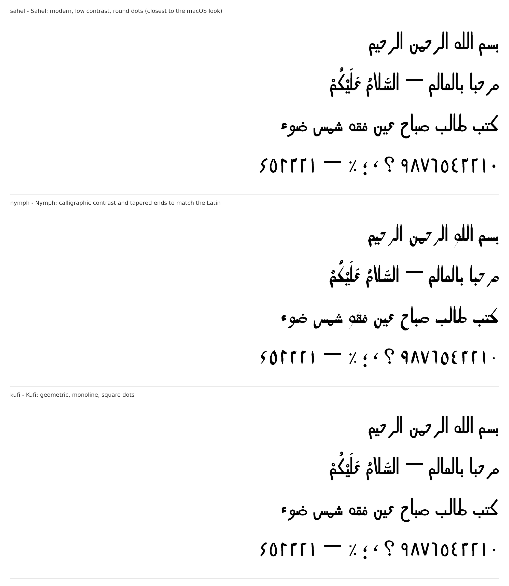

# Nymph Heading

A display family grown from the caps-only *Irvin Heading 1.001*. It has a real lowercase, every Latin-script European language, Greek, and Arabic (including Persian and Urdu letters). It comes in five weights, Light to Bold, plus a single variable font.




## What's in it

| | |
|---|---|
| **Scripts** | Latin, Greek (monotonic), Arabic, Persian and Urdu letters |
| **Glyphs / characters** | 966 / 600 |
| **Weights** | Light 300, Regular 400, Medium 500, SemiBold 600, Bold 700, plus a variable font with a `wght` axis from 300 to 700 |
| **Code pages** | Windows 1250 (Central Europe), 1252 (Western), 1253 (Greek), 1254 (Turkish), 1256 (Arabic) and 1257 (Baltic) are all complete |
| **Formats** | OTF (CFF, hinted with otfautohint), TTF (hinted with ttfautohint), WOFF, WOFF2, and the variable font as TTF and WOFF2 |

All files pass the OpenType Sanitizer, the font checker Chrome and Firefox use.

### Lowercase

The lowercase is drawn as real lowercase, in the idiom of the capitals:

- The stems have the I's softened corners.
- The bowls have the O's vertical stress.
- The right-hand stems of `a d h l m n u` end in the curled foot of R and K.
- `f g j t y` take the hooked tail of J and the figures.
- `k` uses K's own curled leg.
- `c o s v w x z` keep the capitals' shapes, as they do in almost every typeface, re-proportioned and re-weighted.

The small capitals from the previous version are still there, through `smcp` and `c2sc`.

### Greek

Capitals that share a shape with Latin reuse the Latin glyphs. The rest are built from the capitals' own parts:

- `Γ`: the L turned over.
- `Λ Δ`: the A without its bar.
- `Ξ`: the E's flared arms as bars.
- `Π`: the H's stems.
- `Σ Φ Ψ Ω`: built the same way from existing parts.

The lowercase is drawn with the same stroke system as the Latin lowercase. It has the full tonos and dialytika set, plus the Greek question mark and ano teleia.

### Arabic

- **Letters:** all 28 letters plus hamza and its carriers (أ إ آ ؤ ئ ء), alef wasla, teh marbuta and alef maksura.
- **Persian:** پ چ ژ ک گ ی.
- **Urdu:** ٹ ڈ ڑ ں ھ ہ ے.
- **Forms:** every joining letter has its isolated, initial, medial and final form. The six non-joining letters (ا د ذ ر ز و and their relatives) have only isolated and final forms.
- **Joins:** forms connect through one baseline stroke that runs flush to the glyph edges at the same thickness in every letter, so joins are seamless at every weight.
- **Lam-alef:** لا لأ لإ لآ ligatures through `rlig`. They still form when vowel marks sit between the lam and the alef.
- **Vowel marks:** fatha, damma, kasra, their tanween forms, shadda, sukun, maddah, hamza above and below, and superscript alef. They position through `mark`, and stack through `mkmk` (shadda + fatha, for example).
- **Digits:** Arabic-Indic ٠١٢٣٤٥٦٧٨٩ and Persian ۰۱۲۳۴۵۶۷۸۹, where ۴ ۵ ۶ have their own shapes.
- **Punctuation:**
  - the Arabic comma ، (turned);
  - the semicolon ؛ (turned);
  - the question mark ؟, mirrored for right-to-left;
  - ٪ ٫ ٬;
  - tatweel ـ;
  - ZWJ, ZWNJ and the direction marks.

**Pick an Arabic style.** The Arabic is drawn as skeletons, which a stroke model then turns into outlines, so the same letters come in several styles. `specimen/arabic-variants.png` shows them side by side:

- **sahel** (the default): modern, low contrast, round dots; closest to the macOS Arabic system look.
- **nymph**: calligraphic contrast, tapered ends and diamond dots, echoing the Latin.
- **kufi**: monoline and geometric, with square dots.

Build with the one you choose:

```bash
python3 tools/build.py --arabic-style nymph
```



### OpenType features

| Feature | What it does |
|---|---|
| `kern` | The original kerning extended to all accented capitals. Adds lowercase kerning by shape class, capital–lowercase pairs, and punctuation |
| `mark`, `mkmk` | Positions Latin, Greek and Arabic marks on any letter, and stacks them |
| `init`, `medi`, `fina`, `rlig` | Arabic joining forms and lam-alef |
| `ccmp` | `i j` lose their dot under an accent placed above them |
| `locl` | Romanian and Moldovan `ş ţ` become `ș ț` |
| `smcp`, `c2sc` | Small capitals |
| `case` | Raises guillemets and the middle dot for all-caps text |
| `frac`, `numr`, `dnom`, `sups`, `subs`, `sinf`, `ordn` | Fractions, superiors and inferiors, ordinals |
| `ss01` | Letters standing on a rule, for caps and lowercase |
| `dlig` | The original capital ligatures (`THE AND FOR LL …`) |

## Files

| Path | Use |
|---|---|
| `fonts/variable/NymphHeading[wght].ttf` | One file with every weight, for apps that support variable fonts |
| `fonts/variable/NymphHeading[wght].woff2` + `nymph-heading-variable.css` | The variable font for the web |
| `fonts/otf/` | Static weights for desktop design apps |
| `fonts/ttf/` | Static weights for anything that wants TrueType (Office, Android, game engines) |
| `fonts/webfonts/` | Static WOFF2 and WOFF files with a ready `@font-face` CSS file |
| `source/NymphHeading-Regular.ufo` | Editable Regular master; opens in Glyphs, FontLab, RoboFont or Fontra |
| `source/NymphHeading-Original.ttf` | The untouched input |
| `specimen/` | Glyph sheets per script, the text specimen, weights, Arabic variants, and `index.html`, a live tester with a weight slider |

## How it's built

The build is code, so everything can be regenerated:

| File | What it does |
|---|---|
| `tools/build.py` | The pipeline: original caps, marks, constructed letters, lowercase, Greek, Arabic, composites, kerning, features, weights, compiling |
| `tools/strokes.py` | Expands skeleton strokes into outlines with a broad-nib contrast model, then fits smooth curves back to them |
| `tools/lowercase.py`, `tools/greek.py`, `tools/arabic.py` | The letter drawings |
| `tools/arabic_build.py` | Puts the Arabic into the font: names, anchors, joining features |
| `tools/specimen.py`, `tools/arabic_variants.py` | Render the specimens |

Each weight is made from the Regular drawing by growing or shrinking the ink of every outline, horizontally and vertically by separate amounts, with point structure preserved. That is why Light, Regular and Bold interpolate into the variable font.

```bash
pip install -r tools/requirements.txt
```

```bash
python3 tools/build.py
```

```bash
python3 tools/specimen.py
```

## Known limits

- Every new glyph (Latin lowercase, Greek, Arabic) was drawn by code from the capitals' parts and stroke models, not by hand. The shapes are consistent and clean, but a type designer's pass would refine curves and spacing. Look closely at `ß ð ƒ ξ ζ` and the Arabic before using them big.
- The weights are derived from one drawing. Light and Bold keep the Regular's proportions rather than being redrawn. That reads naturally across this range, but it is not a hand-drawn Bold.
- Arabic has no kerning yet, and its marks attach to the lam-alef ligature as a whole rather than to each part.
- Not included: long s `ſ`, Vietnamese, Cyrillic, Mac-Roman math (`∂ ∑ √ ∫ ∞ π`), Urdu digits, and Arabic presentation forms (`U+FB50–FEFF`). Modern text doesn't need the presentation forms.

## Licence

The original file carries no copyright or licence string, and its `fsType` is 4 (preview & print embedding). Check the licence of Irvin Heading before you redistribute or sell anything derived from it. That includes keeping it in a public repository.
