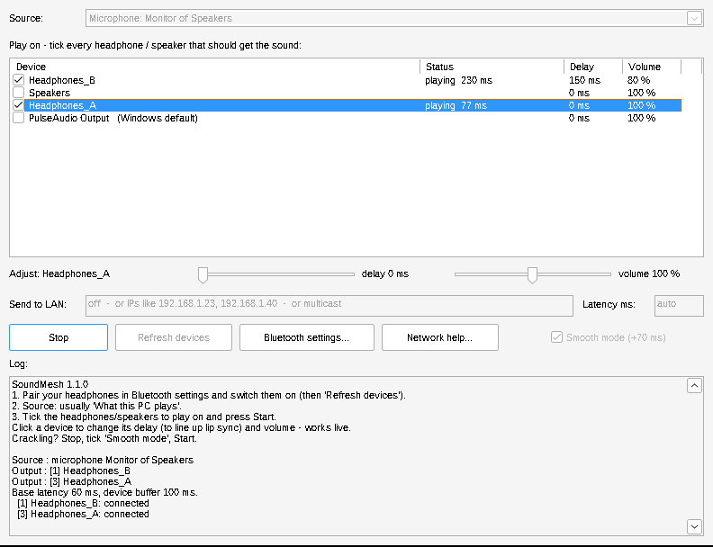
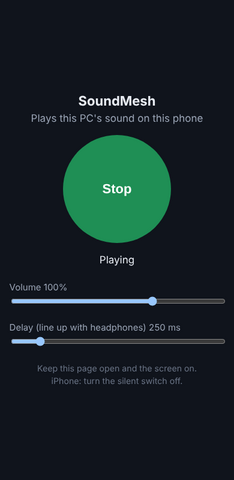

# SoundMesh

Play the same sound on several Bluetooth headphones, wired headphones, speakers, phones and other computers at the same time, from a Windows 10/11 PC.

- **One portable `.exe`** (~370 KB). Nothing to install, no driver, no admin rights, no dependencies.
- **Fast and light:** native C++ with WASAPI and real-time audio threads, about 5–10 MB of RAM.
- **Auto mode:** finds your headphones, ticks them and starts playing. Headphones you switch on later join by themselves, and all of them stay in sync. Each one has a live delay and volume slider.
- **Phones, both directions, no internet:**
  - **PC → phone over Wi-Fi:** scan a QR code and the phone's browser plays the PC's sound. No app needed.
  - **Phone → PC over Bluetooth:** the PC becomes a Bluetooth speaker for your phone, and the phone's sound goes on to all your headphones.
- **Other PCs on the network:** SoundMesh ↔ SoundMesh, or [Scream](https://github.com/duncanthrax/scream) receivers on Windows/Linux/Android/Raspberry Pi.
- **Never uses the internet, and shows it:** a meter in the window counts every byte SoundMesh sends or receives. It shows *Internet data used: 0 bytes* in green, and turns red if anything ever goes outside your local network. See [Proving it uses no internet](#proving-it-uses-no-internet).

## Quick start

1. Pair every headphone once in **Settings → Bluetooth & devices** (the **Bluetooth settings…** button opens it).
2. Switch them on and double-click **`soundmesh.exe`**. It ticks every headphone it finds and starts playing what your PC plays.


*(Screenshot from the Wine test run with virtual devices. On your PC the list shows your real headphones.)*

3. **Click a device** to set its **delay** (line up lip sync) and **volume**. Tick or untick devices any time; changes apply immediately. Auto mode won't re-tick a headphone you unticked until it reconnects.

Headphones are recognised by what Windows reports about the device (Bluetooth music mode, or a Headphones/Headset type), with the device name as a fallback. Wired 3.5 mm headphones work too. On many laptops the jack is listed as *Speakers*; tick it once and SoundMesh remembers.

If Windows switches the default output to newly connected headphones, SoundMesh follows it. That headphone plays the sound directly (shown as *plays directly*), and the others get a copy.

**Wired + Bluetooth together (e.g. YouTube on jack headphones and earbuds):** make the *earbuds* the Windows default, tick the jack, and raise the jack's delay (try 150–200 ms) until both sound in step. Bluetooth always lags, so delay the wired one.

### Phones

**Listen on my phone (Wi-Fi)…** → tick *Let phones listen*. Then scan the QR code with the phone (same Wi-Fi), or type the address shown, and tap **Play**:



- The page has its own volume and a **Delay** slider for lining up with the headphones.
- Several phones can listen at once.
- **VLC, smart TVs and Wi-Fi speakers** that can open a URL can use `http://<pc>:4011/stream.wav`.
- Keep the page open and the screen on.
- Windows asks once to allow SoundMesh through the firewall; allow it on Private networks.

**Play my phone here (Bluetooth)…** → tick *Let my phone play through this PC*, then connect to the PC from the phone's Bluetooth menu (or pick the phone and press **Connect**). The PC acts as a Bluetooth speaker, so the phone's music, videos and calls-audio play on the PC and SoundMesh sends them on to every ticked headphone. This needs Windows 10 version 2004 or newer, or Windows 11, and the phone must be paired with the PC once. All Bluetooth audio shares one radio, so a phone plus several headphones may stutter.

**Phone → PC over Wi-Fi is not possible without an app on the phone.** Browsers cannot capture a phone's system audio (only its microphone, and only over HTTPS), so this direction uses Bluetooth.

### Proving it uses no internet

You don't have to take the app's word for it:

- **The meter** (bottom of the window) counts every byte SoundMesh sends or receives. Anything not addressed to a private home-network address (`192.168.x.x`, `10.x.x.x`, `172.16–31.x.x`, link-local, local multicast) counts as *internet*. Every couple of seconds it also asks Windows for the list of network connections this process has open. It shows *Internet data used: 0 bytes* in green, or a red warning naming the outside address.
- **Unplug test:** pull the cable from the router's internet/WAN port and keep the router on. Headphones, phones over Wi-Fi and the Bluetooth receiver all keep working, because traffic between devices in your home never leaves the router.
- **Windows' own tools:** run `resmon` (Resource Monitor) → *Network* → tick `soundmesh.exe` to see every address it talks to, or run `netstat -ano` and look for its process ID. The **Check it yourself…** button explains both. Windows' *Data usage* page also counts traffic inside your home network, so a few MB there is not internet use.
- **By design:**
  - It never looks up a name (no DNS).
  - It has no update check, telemetry or ads.
  - It sends network audio with TTL 1, so the first router drops it instead of forwarding it.
  - The phone server refuses connections from outside your local network.
  - The LAN receiver ignores packets from outside it.

### More options

**More options…** shows the rest:
- **Source:** what the PC plays, a specific device, a microphone, or another PC.
- **Send to LAN:** other PCs running SoundMesh or Scream.
- **Latency:** *auto* is 60 ms, or 120 ms for a LAN source.
- **Smooth mode:** adds ~70 ms of buffering per device. Use it if a device crackles.
- **The log.**

Settings are saved in `soundmesh.ini` next to the exe, so it stays portable.

### Command line

`soundmesh.exe` accepts the options below and starts playing immediately (handy for a desktop shortcut). `soundmesh-cli.exe` is the same engine as a console program, with an interactive text wizard and live commands (`s` status, `d N MS` delay, `v N PCT` volume, `q` quit).

```
soundmesh-cli list                                 show devices and their numbers
soundmesh --to auto                                every headphone, now and when switched on later (default)
soundmesh --to "WH-1000,AirPods"                   default device -> 2 headphones (match by name)
soundmesh --to 2,3 --delay 3=80 --vol 2=90         by number, with lip-sync delay and volume
soundmesh --from loop:1 --to 2,3                   capture a specific playback device
soundmesh --from mic:1 --to 2,3                    microphone -> headphones
soundmesh --to 2 --net 192.168.1.23,192.168.1.40   headphone + two other devices on the LAN
soundmesh --from net --to 2,3                      receive from another PC and play on local headphones
soundmesh --to 2,3 --buffer 100                    smooth mode
soundmesh --phones                                 phones listen over Wi-Fi (http://<pc>:4011)
soundmesh --phone-in                               PC acts as a Bluetooth speaker for paired phones
```

Device numbers can change when devices connect or disconnect. Names (or any part of a name) are more reliable.

## Which device is the "source"?

Loopback captures what Windows plays on the **default** playback device, and that device keeps playing the sound too. SoundMesh refuses to also send to that device, because doing so would cause an endless echo. You have two good setups:

- **Speakers as the default (recommended):** set the laptop speakers as the Windows default, turn their volume down, and send to all headphones with `--to 2,3`. Every headphone then goes through SoundMesh, so all of them can be synced with `d N MS`. On most PCs the captured sound does not depend on the speaker volume slider. If yours goes silent, use any spare output (such as HDMI with no monitor attached) as the default instead.
- **Headphone 1 as the default:** headphone 1 plays natively with the lowest latency, and SoundMesh mirrors to the others. You can only delay the mirrored ones.

## Bluetooth: limits

- **2 headphones work well on almost every PC, and 3 work on many.** Windows uses only **one** Bluetooth radio at a time, and every A2DP stream shares it. Past that point, extra headphones stutter no matter what software you use. To go beyond the limit, run SoundMesh on a second PC or laptop with `--from net` and pair more headphones there (see below).
- **Avoid "Hands-Free" endpoints.** Every headset shows up twice: `Headphones (X)` is stereo music quality, and `Headset (X Hands-Free)` is call mode with low quality. Opening the Hands-Free one forces the headset into call mode. SoundMesh flags these endpoints, and name matching always picks the stereo one.
- **Each Bluetooth headphone has its own built-in latency** (roughly 100–300 ms). Use `d N MS` while watching a video until lips and sound match on every headphone.
- **2.4 GHz Wi-Fi and Bluetooth share the same airwaves.** If audio crackles while the LAN is in use, put the PC on **5 GHz** Wi-Fi or Ethernet.
- Windows 11 has a "Shared audio" preview feature, but it works only with **LE Audio** headphones (a few recent models). SoundMesh works with any classic Bluetooth headphone.

## LAN outputs (other PCs, phones, Raspberry Pi), no internet needed

Audio goes over your **local** network only. The router just switches packets between devices in your home, and nothing goes to your ISP. It even works with the router's internet (WAN) cable unplugged.

**On the sending PC:** type the receivers' IPs (or `multicast`) into **Send to LAN**, or:
```
soundmesh --to 2 --net 192.168.1.23            unicast to one device (best on Wi-Fi)
soundmesh --to 2 --net 192.168.1.23,192.168.1.40
soundmesh --to 2 --net multicast               one stream that every receiver picks up (best on Ethernet)
```

**On each receiver:**

| Receiver | How |
|---|---|
| Another Windows PC | SoundMesh with source *Another PC on the network* (its own Bluetooth headphones join the group too) |
| Linux / Raspberry Pi | the Scream receiver: `scream -u -o pulse` for unicast, or `scream -o pulse` for multicast |
| Android | the Scream Android receiver (`Receivers/android` in the Scream repo) |

Bandwidth is about 1.4 Mbit/s per unicast receiver (44.1 kHz, 16-bit, stereo), which is tiny for any Wi-Fi.

### Router / modem and Windows settings

You do **not** need "media sharing", DLNA, UPnP, port forwarding or a hotspot. Check these settings:

1. **Put every device on the same network.** Use the same router and the same subnet (all addresses look like `192.168.1.x`). **Do not use the Guest Wi-Fi.** Guest networks block devices from talking to each other.
2. **Turn off AP isolation.** It is also called *Client isolation*, *Wireless isolation* or *Station isolation*, usually under Wireless → Advanced. When it is on, devices on Wi-Fi cannot reach each other.
3. **Set the Windows network to Private:** Settings → Network & internet → Wi-Fi (or Ethernet) → your network → **Private network**.
4. **Allow the firewall.** Windows asks the first time a PC receives (source *Another PC on the network*). Allow it for **Private networks**. Or run this once in an admin terminal on each receiving PC:
   ```
   netsh advfirewall firewall add rule name="SoundMesh" dir=in action=allow protocol=UDP localport=4010 profile=private
   ```
5. **Give receivers fixed addresses.** In the router, under *DHCP reservation* / *Address reservation*, pin each receiver's IP so your `--net` command keeps working. Find a device's IP with `ipconfig` (Windows) or in its Wi-Fi details.
6. **Multicast only:** Over Wi-Fi, routers send multicast at the slowest rate, which often sounds choppy. Use unicast IPs on Wi-Fi. If you use multicast, enable *IGMP snooping* or *Multicast to unicast* (sometimes called *IPTV* settings) if your router has it. If the PC has several adapters (VPN, VirtualBox), pick the right one with `--iface 192.168.1.10`.
7. **No router at all?** Connect two PCs directly with an Ethernet cable. Windows gives both `169.254.x.x` addresses, and `--net multicast` works out of the box.

## How it works

```
                 +-> ring buffer -> drift-corrected resampler -> WASAPI -> Headphones A (BT)
 source -------->+-> ring buffer -> drift-corrected resampler -> WASAPI -> Headphones B (BT)
 (WASAPI loopback|-> ring buffer -> ...                                -> USB / HDMI / speakers
  / mic / UDP)   +-> 16-bit PCM, 1157-byte UDP packets (Scream format) -> LAN devices
```

- **Capture:** event-driven WASAPI shared mode, using loopback for "what you hear". It runs on an MMCSS "Pro Audio" priority thread.
- **Each output:** its own thread and a lock-free single-producer/single-consumer ring of about 2.7 s, holding `latency + delay` ms of audio.
  - Every device's clock runs at a slightly different speed, so a smoothed buffer-level controller nudges the playback rate by at most ±0.4 %. That correction is inaudible, and it means the outputs never drift apart or slowly build up delay.
  - Large jumps (a delay change, a reconnect) are applied instantly.
- **Format conversion:** Windows' own resampler (`AUTOCONVERTPCM`) converts each stream to whatever the device needs, such as the A2DP rate. Disconnected headphones are retried every 2 s and resume automatically.
- **Why there is no driver:** loopback already captures everything Windows plays, without any install. A kernel driver (the way Scream and Voicemeeter work) would need signing, admin rights and an installer, and a bug in it could crash the PC. That conflicts with "one portable exe".

## Build

On Linux, cross-compile with mingw-w64:

```
sudo apt install mingw-w64
./build.sh                 # -> dist/soundmesh.exe (window) + dist/soundmesh-cli.exe (console)
```

On Windows with MSYS2, run the same `windres`/`gcc`/`g++` lines from `build.sh`. The GUI is plain Win32 (`src/gui.inc`), with no frameworks. Other source files:
- `src/web.inc`: the phone page and its WebSocket/WAV streaming.
- `src/btsink.inc`: the Bluetooth receiver. It uses Windows' `AudioPlaybackConnection` through the raw WinRT ABI, with combase loaded at runtime.
- `src/third_party/qrcodegen.*`: [QR Code generator](https://github.com/nayuki/QR-Code-generator) by Project Nayuki (MIT).

## Tested

The build was tested in Linux under Wine with virtual PulseAudio devices:

- **Fan-out:** a 1 kHz tone was fanned out to two outputs. Both played it at the correct pitch, with full level and no clicks. Buffers held their 60 ms target with no dropouts.
- **LAN:** PC→PC over UDP played clean 440 Hz audio on the receiver.
- **Scream compatibility:** the official Scream receiver decoded SoundMesh's stream correctly.
- **GUI:** under Xvfb, Start, Stop and close all worked. Settings were saved and restored, and the delay and volume sliders applied live.
- **Phones:** headless Chromium opened the phone page and pressed Play. It received the stream in real time (about 172 KB/s at 44.1 kHz) and scheduled every packet. `/stream.wav` delivered a clean 1 kHz tone with no clicks.
- **Data meter:** streaming to a browser and a LAN address showed 2.3 MB local and 0 bytes internet. A test stream aimed at a public address (8.8.8.8) was flagged as internet (194 KB), and TTL 1 kept it from going past the first router. The open-connections check needs real Windows; under Wine it always reported 0.
- **Not testable here:** the QR code display was checked visually, but not scanned. The Bluetooth receiver only reports "not supported" under Wine, which has no such API. It needs a real Windows 10 2004+/11 PC and a paired phone.

Wine does not implement WASAPI loopback, so loopback capture still needs to be confirmed on real Windows. It uses the standard, documented API.
